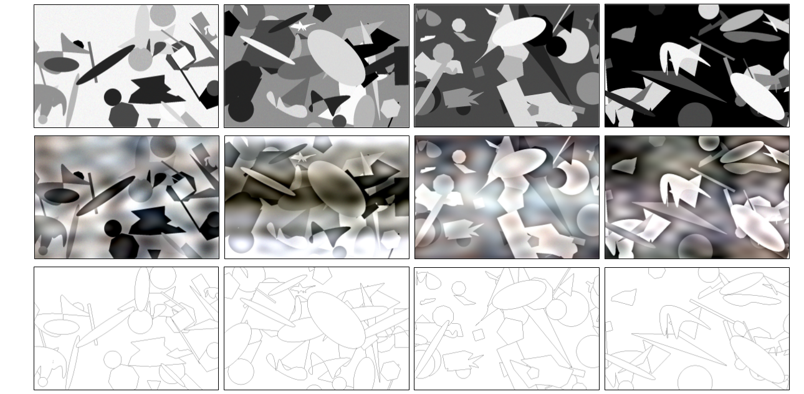

# When Ground Truth Is Not Unique: Rethinking Edge Detection Evaluation with MDBD (Paper)

## Overview

<div style="text-align:center">
</div>

Coming soon

## Citation
If you use the Synthetic GT, please cite the following paper 

```
@conference{icprs2017
}
```

## Acknowledgments
For more info and to start using the template, please go to the original repository: [Here](https://github.com/eliahuhorwitz/Academic-project-page-template)

## Website License
<a rel="license" href="http://creativecommons.org/licenses/by-sa/4.0/"></a><br />This work is licensed under a <a rel="license" href="http://creativecommons.org/licenses/by-sa/4.0/">Creative Commons Attribution-ShareAlike 4.0 International License</a>.
